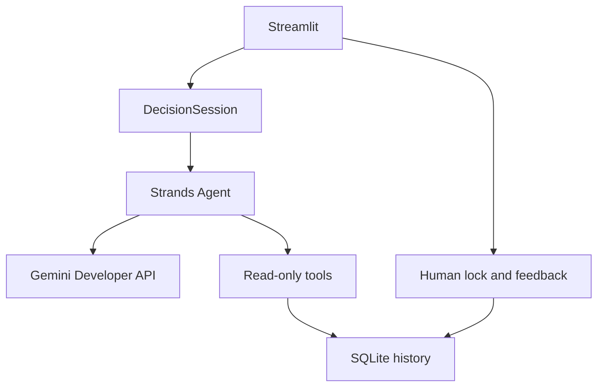

# Decision Lock — Gemini release architecture

Python 3.12, Streamlit, AWS-origin Strands SDK, Gemini Developer API and local SQLite.
Gemini replaces the original Ollama/Bedrock provider paths. The project is not deployed.

## Components and runtime

- app.py: widgets, verdict, evidence, model setting and friendly errors.
- config.py: Gemini model, timezone, SQLite path, turn/timeout bounds; no API key field.
- providers.py: private key resolution and current strands.models.gemini.GeminiModel.
- agent.py: actual Strands loop, validated response schema and sanitized errors.
- controller.py: bounded context questions, editable review, retry preservation, explicit locks.
- models.py: validated AgentReply and follow-up FinalReply, tool ledger and turn response.
- scoring.py: pure deterministic arithmetic/validation; tools.py: bound read-only tools.
- storage.py: parameterized SQLite writes, idempotency token, upserted feedback/history.
- doctor.py: offline setup check, no generation or key output.
- Start.ps1 and Launch.py: Windows encrypted-key startup, health-checked browser launch.

Default model is stable gemini-3.5-flash-lite, listed by Google with function calling,
structured outputs and a free tier. GEMINI_MODEL can be changed to another accessible
compatible model. Strands 1.59.0 GeminiModel uses Google GenAI's current SDK through
client_args. vertexai=False forces the Developer API rather than Vertex AI.
The private GEMINI_API_KEY takes precedence over GOOGLE_API_KEY.

No alternate-provider factory, Ollama runtime, local model download or Bedrock call remains.
The provider label records the actual configured Gemini model with each turn/lock.

## Agent behavior and tools

Each attempt creates a fresh Strands Agent with tools and the concise system instructions.
The model chooses whether/which tools to call. The request envelope carries the phase,
choice, context answers, remaining question budget, reviewed summary and history permission.

ContextReply permits clarification, context summary, information or refusal; it excludes
recommendations. ReviewReply also excludes questions. FinalReply permits recommendations,
information or refusal, excluding questions and context summaries. A recommendation needs
one chosen option, 2–4 reasons and one next action.

The controller owns the question count (maximum four total) and rejects repeated question
strings, budget overflows and premature recommendations. Semantic repetition or inaccurate
summaries still require user review. Blank answers are marked Not provided. Users may skip
remaining questions, then edit and confirm the summary before comparison. Corrected context
takes precedence over original answers in the prompt. Locking requires confirmed context and
an actual recommendation. There is no agent-callable save tool.

Retries retain answers and the pending phase without appending duplicates. Context approval
and database locking are separate steps. The saved record includes the reviewed summary and
context answers. Question/review tools may use history only with explicit consent. Each
phase uses a fresh Strands loop and consumes a public-demo request reservation.

score_options requires 2–5 unique options, 1–6 criteria, finite 0–10 scores and nonnegative
weights with at least one positive value. Scores always mean better fit, not raw effort.
Weights are scaled then normalized; math.fsum adds products. Ranking, original scores,
factors and explicit first-place ties are returned. The documented example yields 8.3
and 6.1. Missing data returns needs_clarification; invalid data returns invalid_input.
Nothing is imputed. Model-proposed scores must be disclosed as estimated judgments.

get_current_time uses datetime/zoneinfo in APP_TIMEZONE (Asia/Kolkata by default).
get_recent_decisions permits 1–10 records only after the UI's permission checkbox. Its
executable check prevents a database read even if the model requests history without
permission. With permission enabled, history becomes Gemini input. The sidebar reads
history locally. Each actually executed tool appends its name/result to a request-local
ledger; the evidence expander uses this ledger rather than claims in the model's text.

Gemini max_output_tokens is 2048 per call. SDK limits default to eight loop turns and
6000 cumulative output tokens. GenAI HTTP retry attempts are one (no application retry
loop). async wait_for bounds invocation time at 180 seconds by default; HTTP timeout
uses milliseconds. Synchronous SDK work may delay cancellation. Token caps checked
at turn boundaries may overshoot; none of these bounds is a financial cap.

Quota (429), access/request (400/401/403) and unavailable model (404) errors are mapped
to friendly messages. Raw provider payloads/headers are never printed by app logs.
Dependency logs are muted during agent requests; application logs record exception classes.

## Persistence and Windows setup

SQLite decisions contain id, unique lock_token, UTC time, user_problem, recommendation,
next_action, reasoning_summary JSON and actual provider/model. Feedback contains one
unique decision_id reference, helpful 0/1 and UTC time. Foreign keys, transactions and
SQL parameters are used. Lock retries do not duplicate decisions; votes can be changed.
The database is not encrypted. Only locks/feedback survive restarts; unsaved chat is session-only.

The setup ZIP places project/ alongside Setup.cmd. Running setup copies that payload
into **Lock alongside Setup.cmd**, using the script directory, including a D: drive
location. An unrelated existing Lock directory is refused; the installer's own marked
folder can resume. There is no Desktop special-folder redirect.

Start.ps1 prompts for a masked key and optionally retains it encrypted with Windows
user DPAPI in .gemini-key.dpapi. It decrypts to the child environment at startup. No
plaintext key is written by the launcher. Normal environment/.env configuration is
also supported. The key file, private .env and database/journals are ignored and excluded.

Launch.py reuses only a matching previously started process (PID, creation time, app
command and healthy endpoint), otherwise chooses a free local port in 8501–8520. The
actual Streamlit health endpoint must respond before the browser is opened. Source
package runtime data contains no key, lock database or launch metadata.

## Validation limits and sources

Offline tests validate arithmetic, state/storage, privacy, adapter construction/request
formatting, API-error sanitization and real SDK protocol execution through fixtures.
Streamlit AppTest validates interaction behavior. Real Gemini API tests are opt-in;
no real key was provided to the build workspace. Browser layout, live inference and
Windows DPAPI/installer execution remain unverified here.

- https://strandsagents.com/docs/user-guide/sdk/model-providers/google/
- https://strandsagents.com/docs/user-guide/sdk/agents/structured-output/
- https://ai.google.dev/gemini-api/docs/models/gemini-3.5-flash-lite
- https://ai.google.dev/gemini-api/docs/pricing

The deprecated Agent.structured_output method is not used. No AWS/Google resources,
RAG, cloud database, deployment or multi-agent orchestration are introduced.

## Public demo entry (deployment update)

streamlit_app.py forces public_demo mode. Each Streamlit browser session owns a
TemporaryDirectory with its own SQLite database; other sessions have unrelated paths.
Public model settings are hidden. A cached DemoBudget reserves up to 50 agent requests
per process by default using a lock. Failed requests count; restarts reset the budget.
The UI describes temporary history rather than incorrectly saying hosted data is saved
on the visitor's computer. Local app.py keeps its original SQLite path.

requirements.txt is the active Community Cloud dependency manifest. Root-level Streamlit
Secrets supply the private key/settings; .streamlit/secrets.toml is ignored. The Cloud
package does not include local databases, keys or Windows runtime/installer files.
